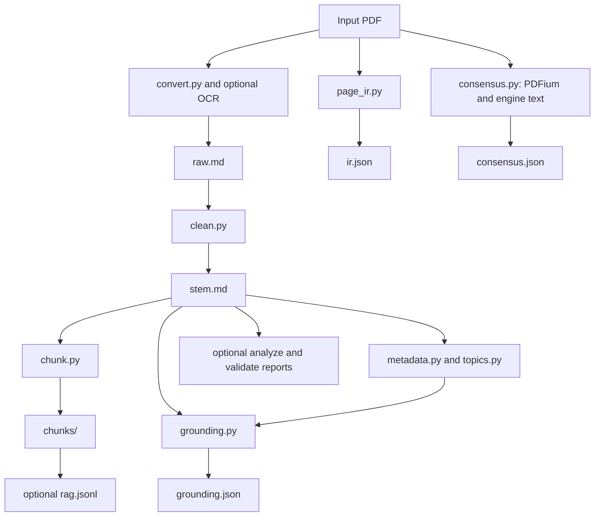

# Architecture

## Primary bundle workflow

`cortexmark run` is implemented by `cortexmark/cli.py`. It accepts one PDF or a directory, resolves an engine, and processes documents independently under `cortexmark-output/<stem>/` by default. `auto` chooses Docling when installed and otherwise MarkItDown; `dual` merges both engines when available. RapidOCR is an optional scanned-page recovery path.

The page-aware IR reads the PDF directly. It does not consume cleaned Markdown. Consensus also reads the PDF separately and obtains reference Markdown from the resolved engine; it does not consume `ir.json`. It can therefore repeat conversion work.

## Components and outputs

| Components | Responsibility |
|---|---|
| `cli`, `convert`, `ocr` | Batch orchestration, conversion engines, local OCR |
| `clean`, `chunk` | Markdown cleanup and heading-based splitting |
| `page_ir`, `pdfutil` | Page classification and source blocks with normalized bounding boxes |
| `consensus` | Token overlap between PDFium page text and engine text |
| `metadata`, `topics`, `grounding` | Extract fields and check their support in cleaned text |
| `semantic_chunk`, `cross_ref`, `algorithm_extract`, `notation_glossary` | Opt-in analysis artifacts |
| `qa_pipeline`, `formula_validate`, `scientific_qa`, `citation_context` | Opt-in diagnostic reports |
| `scientific_ir`, `citation_ir` | Structured scholarly/citation records used by processing modules |
| `rag_export` | Chunk records for retrieval workflows |
| `common`, `paths` | Configuration, paths, logging, and manifest helpers |
| `cleanup` | Validated deletion of configured outputs or local build/cache artifacts through Make targets |

`summary.json` records the completed document's engine, OCR use, counts, and report aggregates. `--json` prints batch summaries and per-document failures. The default processing stages are `convert clean chunk`; `analyze` and `validate` add optional reports. Omitted conversion or cleanup stages require prior outputs in the bundle directory.

## Failures and interpretation

The batch catches per-document failures and continues. A partial success can return exit code zero; consumers should inspect warnings and the JSON failure list. Failed documents can leave partial output directories.

IR, consensus, metadata/topic extraction, grounding, and individual analysis/validation steps catch errors independently. Their warnings may accompany a successful core conversion, and their artifacts may be absent. Summary defaults do not distinguish every missing report from a measured zero.

Consensus confidence is a token-coverage heuristic. Grounding uses source-text matching for generated fields. Neither establishes semantic equivalence, correctness of equations/proofs, or reliable scholarly metadata. Students should compare important passages and objects with the original PDF.

## Legacy runner and standalone utilities

`python -m cortexmark.run_pipeline` reads `configs/pipeline.yaml` and runs selected `convert`, `clean`, `chunk`, `render`, `analyze`, and `validate` stages. Its outputs use configured trees rather than primary per-document bundles. `--session-name` scopes local inputs and results under `sessions/`. The legacy manifest supports skipping unchanged work.

`render_templates` populates templates in the source tree from an outline or folder/content structure. Use a local working copy when rendering. The CLI also retains individual stage subcommands.

Standalone modules provide parallel helpers, OCR/formula diagnostics, figure catalogs, document classification, citation graphs, multi-format export, static-site generation, version comparisons, and experimental plugin discovery. Plugins require manual dispatch and are not wired into either runner. See the [API reference](../docs/api/modules.md) for module documentation.

## Development checks

Tests live under `tests/`; Ruff, Pyright, packaging, and documentation checks are configured in the repository tooling and workflows. [CONTRIBUTING.md](../CONTRIBUTING.md) lists local commands. These checks do not certify fidelity of an arbitrary converted paper.
