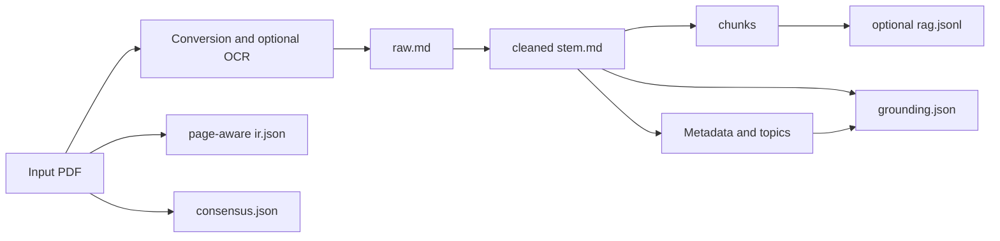

# Architecture Overview

## Default bundle workflow

`cortexmark run` resolves an engine, processes each PDF independently, and writes a bundle per document. `auto` selects Docling when installed, otherwise MarkItDown. RapidOCR is an optional scanned-page recovery path.

The IR reads the PDF directly, classifies pages, and extracts source blocks with normalized top-left bounding boxes. Consensus separately reads PDFium text and the selected conversion engine's output; it does not consume the IR and may repeat engine conversion.

Consensus confidence measures token coverage. Grounding checks generated field values against cleaned source text. Both are heuristics, without semantic or mathematical verification. IR, consensus, grounding, and optional analysis reports can fail independently and leave artifacts absent while core conversion succeeds. Inspect warnings and compare important passages against the PDF.

## Legacy runner and utilities

`python -m cortexmark.run_pipeline` reads `configs/pipeline.yaml` for selected `convert`, `clean`, `chunk`, `render`, `analyze`, and `validate` stages. It writes configured shared trees, or named session directories, rather than the main command's document bundles.

Rendering populates templates in the configured source tree from an outline or content structure. Standalone utilities provide additional diagnostics, citation graphs, exports, static-site generation, and manual plugin dispatch. See [Legacy Pipeline Stages](../guide/pipeline-stages.md) and the [API reference](../api/modules.md).
